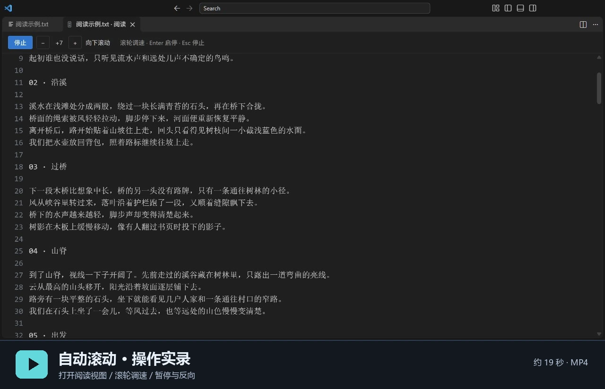
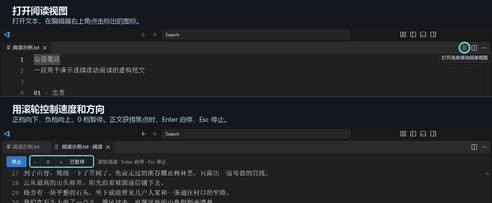

# 自动滚动

面向 Windows 桌面版 VS Code 1.100 或更高版本。阅读视图从原编辑器当前阅读位置附近开始，以像素为单位连续滚动，默认按视图宽度自动换行，续行共用原来的行号。支持查看未保存的内容。

## 约 19 秒操作演示

[](https://github.com/Cormor/SmoothAutoScroll/releases/download/v1.3.0/smooth-auto-scroll-demo-v1.3.0.mp4)

## 快速上手



1. 打开文本文件，点击编辑器右上角的「打开连续滚动阅读视图」图标。新标签打开后，默认以 `+1` 档连续向下滚动。
2. 在阅读视图里滚轮向下加一档、向上减一档，也可以点 `−` 或 `+`。最低档每秒移动半个显示行。速度为 `−16` 到 `+16`，负数向上，正数向下，`0` 暂停。暂停时可继续用滚轮调到正档或负档。
3. 正文获得焦点时，按 `Enter` 启停。也可点击「停止」或按 `Esc` 停止，正文的滚轮会恢复手动滚动。阅读视图仍可见时，窗口失焦会继续滚动。切换标签或最小化时保留档位和启停状态，回到阅读视图会从离开的位置继续。

阅读视图支持文本选择和复制。要编辑文件，切回原来的编辑器标签。如果右上角图标收在 `…` 菜单里，也可在命令面板搜索「打开连续滚动阅读视图」。

## 安装与更新

在 [GitHub Releases](https://github.com/Cormor/SmoothAutoScroll/releases) 选择版本，下载 `smooth-auto-scroll-版本号.vsix`。在 VS Code 扩展视图的 `…` 菜单选择「从 VSIX 安装」。需要检查更新时，打开 [最新正式版](https://github.com/Cormor/SmoothAutoScroll/releases/latest)，与 VS Code 扩展详情中的版本号比较。更新时用同一入口安装较新的包；插件未上架 Marketplace，不会通过 Marketplace 自动更新。插件不存储自有用户配置。

安装前建议校验发布来源和包内容，从可信的项目源码副本运行以下命令。先把同一 Release 的 `lixing-update-manifest.json` 和 `lixing-update-manifest.sig` 放在当前目录，校验签名与版本；再下载 VSIX，校验通过后才安装。以下以 v1.3.0 为例：

```powershell
node update/verify-release.cjs v1.3.0
node update/verify-release.cjs v1.3.0 smooth-auto-scroll-1.3.0.vsix
```

## 从源码打包

源码无运行时 npm 依赖。使用 Node.js 20 或更高版本，在源码根目录运行：

```sh
npx @vscode/vsce@3.6.2 package
```

## 许可与支持

本项目公开源码，采用砺行非商业源码可见许可；未经单独授权不得商用。见 [LICENSE](LICENSE) 与 [组件和权利声明](THIRD_PARTY_NOTICES.md)。

如愿意支持开发，可下载并在浏览器打开 [支持开发页面](support/index.html)（需保留同目录的 `assets/`）。
